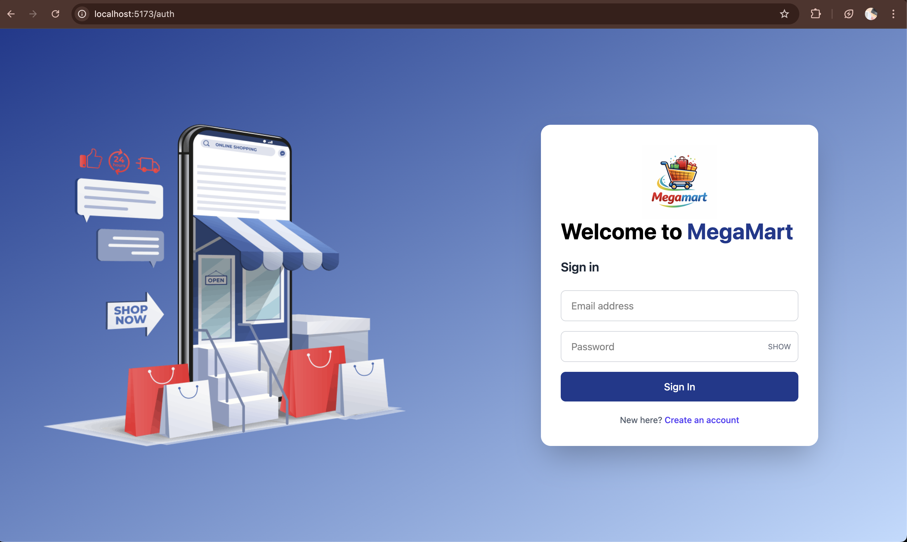
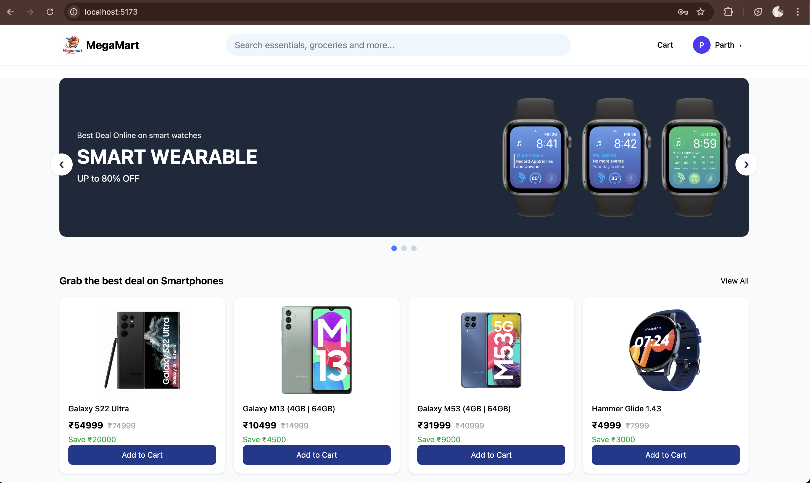
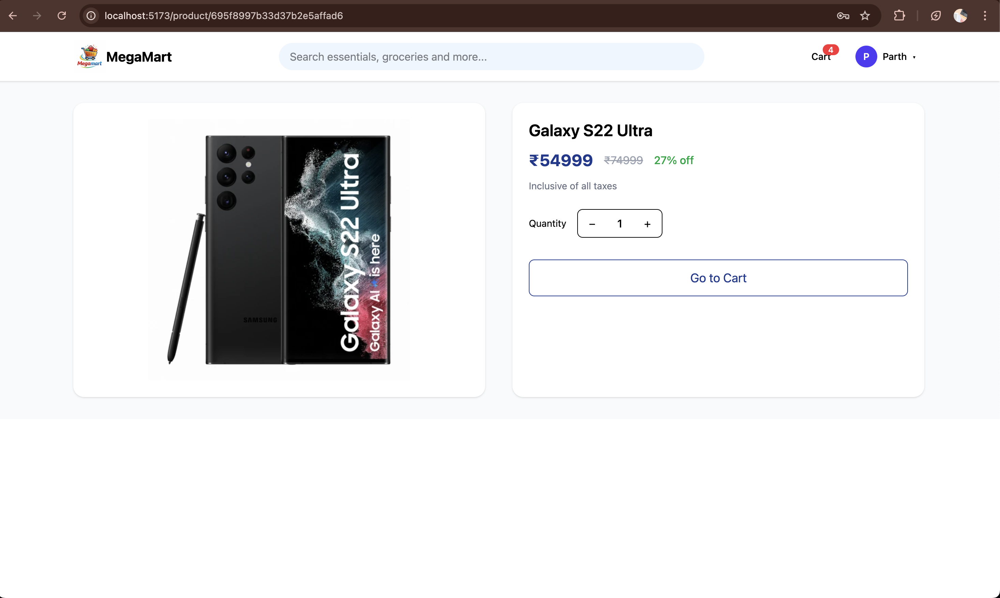
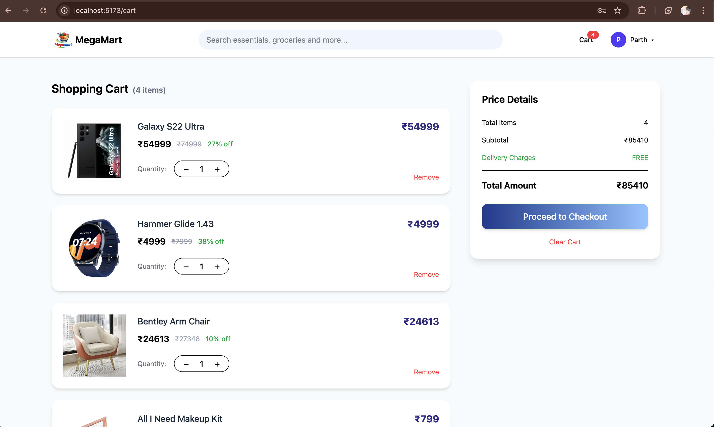
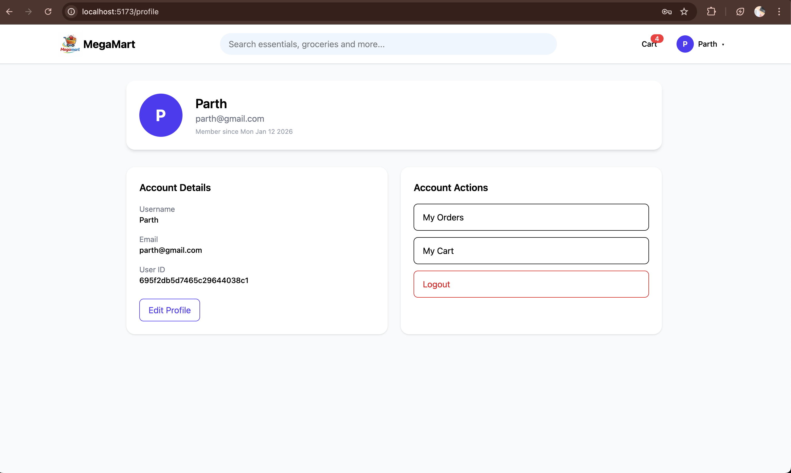

# 🛍️ Megamart – Modern E-Commerce Web App

Megamart is a modern, responsive e-commerce web application built using **React**, **Redux Toolkit**, and **Tailwind CSS**.  
It delivers a smooth shopping experience with real-time cart updates, product quantity synchronization, and a clean, scalable UI.

The application follows a component-driven architecture and leverages Redux Toolkit for efficient global state management, ensuring predictable and maintainable data flow across the app. It includes dynamic product listings, detailed product views, and an optimized cart system that updates instantly without page reloads.

This project is designed following best practices and can be extended easily for real-world production use.

---

## ✨ Features

- 🏠 Product listing page
- 🔍 Product details page with live quantity control
- 🛒 Add to cart / remove from cart
- ➕➖ Quantity management synced across pages
- 🧮 Automatic price & total calculation
- 🔐 Authentication check before adding to cart
- 📱 Fully responsive UI (mobile-first)
- ⚡ Fast performance with Vite
- 🧼 Clean and maintainable code structure

---

## 📸 Screenshots

### Login Page

### 🏠 Home Page

### 📦 Product Details

### 🛒 Cart Page

### Profile

---

## 🛠️ Tech Stack

- **Frontend:** React + Vite  
- **Backend:** Node + MongoDb  
- **State Management:** Redux Toolkit  
- **Styling:** Tailwind CSS  
- **Routing:** React Router DOM  
- **Language:** JavaScript (ES6+)  

